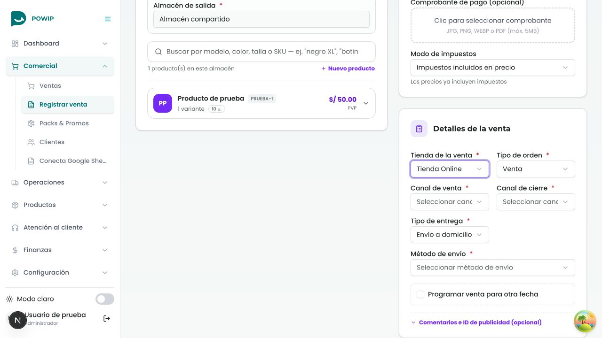

# Tienda de la venta

En **Comercial → Registrar venta → Detalles de la venta**, el campo **Tienda de la venta** identifica a qué tienda pertenece la venta. El **Almacén de salida**, en Productos, identifica de dónde sale el stock. Son elecciones independientes: varias tiendas de una empresa pueden usar el mismo almacén.

- Una única opción se completa automáticamente. Si hay varias tiendas o almacenes, se requiere una elección explícita.
- Seleccionar la tienda de una venta no cambia la tienda de la navegación.
- Con productos en el carrito no se puede cambiar de almacén; se debe vaciar el carrito primero.
- Al editar, se conserva el origen guardado. Una venta histórica sin almacén registrado mantiene ese valor desconocido.
- Si no se puede cargar el contexto o la venta a editar, se bloquea el guardado y se ofrece Reintentar.

El contexto proviene de `GET /order-header/sale-context`, con sesión autenticada. Crear, consultar y editar ventas usan las rutas protegidas `/order-header/manual`. El backend valida la pertenencia de tienda, cliente y almacén a la empresa de la sesión, además de la existencia de las variantes en el almacén. La publicidad puede usar el mismo `storeId`; este cambio no incorpora nuevos informes ni la integración de TikTok.

## Verificación

Pruebas focales: 6 suites y 35 casos pasan, incluyendo selección con almacén compartido, una sola opción, elección obligatoria, edición, historial sin almacén y fallos de carga. Typecheck y build de Next pasan. Las pruebas existentes de pagos, clientes y tipo de entrega se conservaron.

En navegador se creó una venta con una tienda distinta del dueño del almacén, se verificó el payload guardado y se volvió a abrir en edición con ambos valores conservados. La prueba usa exclusivamente API local y datos sintéticos; no crea ventas productivas.

## Publicación

1. Aplicar exclusivamente `OrderStockState1791763200000` en Logistics y desplegar su consumidor compatible.
2. Aplicar exclusivamente `SaleStockContext1791810000000` en Ventas y desplegar las rutas y el outbox.
3. Publicar este frontend después de verificar ambos servicios.

No ejecutar globalmente todas las migraciones: existen migraciones antiguas no aplicadas que no pertenecen a este cambio. Los scripts de verificación SQL de cada servicio prueban las migraciones y el ciclo de stock. El importador histórico de Excel conserva sus estados y no genera reservas nuevas. Los eventos antiguos siguen el protocolo legado con validación de empresa; los nuevos guardan origen y versión para evitar reservas duplicadas o liberar reservas ajenas.

El ledger de stock y el outbox deben conservarse después de recibir ventas nuevas. Una recuperación requiere código compatible con ese protocolo; no eliminar su historial. Revisar los eventos pendientes, reintentos y la cola de errores después de la publicación.
